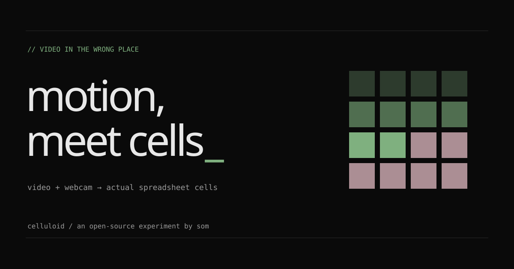
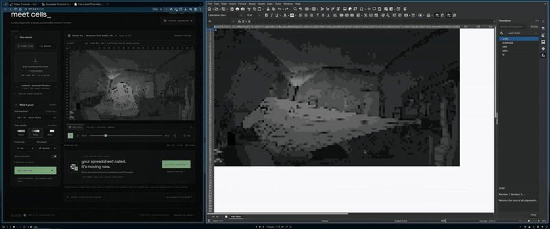

# celluloid

**video, webcam, actual spreadsheet cells.**

An open-source experiment by [Som Chandra](https://somm.tf): turn footage into
moving cell colors, export a real LibreOffice animation, or stream straight
into Calc from your terminal. One repository; no required cloud gateway.



## Demo

Browser studio on the left, the same frames as Calc cells on the right. The
recording ships with this git repository and the GitHub release. The portable
source zip omits media.

[](demo/celluloid-demo.mp4)

[Full recording](demo/celluloid-demo.mp4) (20 seconds).

## Pick a route

| Route                       | What you get                                                                 | Requirements                                                          |
| --------------------------- | ---------------------------------------------------------------------------- | --------------------------------------------------------------------- |
| **Web studio**              | Local video conversion, live webcam, recording, timeline, JSON, animated ODS | Modern browser; HTTPS or localhost for camera                         |
| **Terminal CLI**            | Convert files, play video/JSON, or stream a camera into real cells           | Python 3.10+, FFmpeg; matching LibreOffice + Python UNO for rendering |
| **Web → Calc companion**    | The studio drives real desktop Calc cells                                    | LibreOffice + Python UNO and the included local companion             |
| **Optional conversion API** | FFmpeg decoding when browser codecs are insufficient                         | Python service and FFmpeg, hosted separately                          |

On a MacBook, follow the [macOS setup below](#install-and-run-on-a-macbook).

The browser preview is a custom Canvas grid. Real native playback changes Calc
cell backgrounds. The animated ODS export contains colored cells, frame data
and an embedded LibreOffice Basic player. There is no audio.

## One-command local setup

Download/extract the complete source ZIP or clone the repository, then open a
terminal in its `celluloid` folder. Run the launcher for your OS:

| OS                                     | Command         |
| -------------------------------------- | --------------- |
| Linux                                  | `bash setup.sh` |
| macOS / MacBook                        | `bash setup.sh` |
| Windows (PowerShell or Command Prompt) | `.\setup.cmd`   |

All three use the same [setup script](setup_celluloid.py). The launchers install
Python 3.10+ if needed; the shared script installs missing LibreOffice/UNO tools,
checks a matching Python runtime, starts the local bridge and serves the bundled
web app. **Node.js, npm and pip packages are not required for this route.**

Open the browser window it launches at **http://127.0.0.1:8765**, select
**Connect LibreOffice**, and paste the pairing token from Terminal. Upload a
video or enable the webcam. **Ctrl+C** stops the bridge and its dedicated Calc
process; save your workbook before stopping.

Linux installation supports apt (Debian/Ubuntu), dnf (Fedora) and pacman (Arch).
macOS needs [Homebrew](https://brew.sh/); Windows needs
[App Installer / WinGet](https://learn.microsoft.com/en-us/windows/package-manager/winget/).
Run as your normal user: Linux package steps request `sudo`, and Windows may
show UAC/package prompts. If a package manager is absent, setup explains what to
install. Existing valid native tools are reused on later runs.

Useful options (also accepted by `setup.cmd`):

```sh
bash setup.sh --dry-run       # Show the installation plan without making changes
bash setup.sh --check         # Check existing tools without installing or launching
bash setup.sh --web-only      # Browser studio without LibreOffice
bash setup.sh --with-ffmpeg   # Also install FFmpeg for the terminal CLI
bash setup.sh --install-only  # Install/check tools and exit
bash setup.sh --no-install    # Launch using existing tools only
bash setup.sh --port 4010 --uno-port 2003  # Separate web and LibreOffice ports
```

With Python 3.10+ already installed, `python3 setup_celluloid.py` runs the same
engine directly on any OS (`py -3 setup_celluloid.py` on Windows).
Custom UNO runtimes, ports and setup troubleshooting are covered in the
[setup guide](docs/SETUP.md). Full native installation on physical Windows/Mac
machines still needs acceptance testing; see [verification](docs/verification.md).

## Run the web studio locally

```sh
npm ci
npm run build
npm start
```

Open the printed localhost URL. Drop a video or enable your webcam. Record a
short camera clip, then stop the camera to review/export it. JSON files can be
reimported. Footage and converted frames stay in tab memory until downloaded.
Browser support depends on the actual codec, not just the MP4/MOV extension.

The studio has Som's two visual worlds: **terminal** (green, dense, machine voice)
and **darkroom** (pink, grainier, more space). Themes affect the interface only.
Fonts are self-hosted; there are no analytics, runtime CDNs or mandatory accounts.

## Install and run on a MacBook

For automatic installation and startup, use `bash setup.sh` from the extracted
repository folder after installing Homebrew. The steps below cover manual setup
and diagnosing a native Python/UNO installation.

These steps cover Apple Silicon and Intel Macs running a macOS version supported
by the installed tools. Start in Terminal. Download and extract the source ZIP,
then enter its `celluloid` folder (adjust the path if you extracted it elsewhere):

```sh
cd ~/Downloads/celluloid
```

### 1. Install Node and start the web studio

Install [Homebrew](https://brew.sh/) if needed and follow its printed **Next
steps** to add `brew` to your shell. Then install Node 24:

```sh
brew install node@24
export PATH="$(brew --prefix node@24)/bin:$PATH"
node --version
npm ci
npm run build
npm start
```

Open **http://127.0.0.1:5173**. You can upload a video, preview live webcam cells,
record a clip and export JSON or animated ODS. Allow camera access when your
browser asks. This browser mode needs no Python, FFmpeg or LibreOffice. Leave
Terminal running; **Ctrl+C** stops the server. Repeat the `export PATH=...` command
in a new Terminal session if Node 24 is not already on your PATH.

### 2. Install the optional video and Calc tools

For terminal conversion and actual LibreOffice cells:

```sh
brew install python ffmpeg
brew install --cask libreoffice
open -a LibreOffice
```

Finish LibreOffice's first-launch prompts, then quit that window. If you already
have LibreOffice, use that installation instead of installing another copy.
For a manual download, choose the build matching your Mac's processor from
[LibreOffice](https://www.libreoffice.org/download/download-libreoffice/).

Conversion alone uses Homebrew Python and needs no UNO binding:

```sh
python3 -m native.cli convert "/path/to/input.mp4" -o clip.celluloid.json \
  --width 48 --fps 8 --palette grayscale
```

Replace `/path/to/input.mp4` with your file; keep quotes around paths with spaces.
You can import the resulting JSON into the web studio.

### 3. Check LibreOffice's Python before native playback

Native rendering needs a Python interpreter with LibreOffice's matching UNO
binding, plus Python 3.10 or newer. Homebrew Python is sufficient for conversion
but does not automatically include that binding. Use the application's bundled
interpreter when available:

```sh
CELLULOID_LO="/Applications/LibreOffice.app"
CELLULOID_PY="$CELLULOID_LO/Contents/Resources/python"
CELLULOID_SOFFICE="$CELLULOID_LO/Contents/MacOS/soffice"

"$CELLULOID_PY" -c 'import sys, uno; assert sys.version_info >= (3, 10), "Celluloid needs Python 3.10+"; print(sys.version); print("LibreOffice UNO is available")'
```

The interpreter path follows [LibreOffice's Python documentation](https://dev.blog.documentfoundation.org/2023/12/14/libreoffice-extensions-with-python-part-2-debugging/).
Run the native commands below only after this check succeeds. If you use a
different matching UNO-enabled interpreter, set `CELLULOID_PY` to its full path.
These variables apply to the current Terminal session; set them again in a new
window. No pip dependencies are needed for the companion or CLI.

### 4. Play a video or stream your camera into real Calc cells

Play a local video and keep its final frame visible:

```sh
"$CELLULOID_PY" -m native.cli play "/path/to/input.mp4" \
  --lo-binary "$CELLULOID_SOFFICE" --width 48 --fps 4 --palette grayscale --hold
```

For a live camera, first list available video device indices:

```sh
ffmpeg -f avfoundation -list_devices true -i ""
```

This discovery command normally exits with an error after listing devices.
Choose your camera's **video** index; `0:none` means video device 0 with no audio:

```sh
"$CELLULOID_PY" -m native.cli webcam --device "0:none" --mirror \
  --lo-binary "$CELLULOID_SOFFICE" --width 48 --fps 4 --palette grayscale
```

Replace `0` with the listed camera index. This streams directly into actual Calc
cells without a browser or HTTP server. **Ctrl+C** stops capture/playback and
closes the dedicated LibreOffice process. Save any desired workbook before
stopping. To retain a video's final frame automatically, replace `--hold` with
`--save final.ods`; that saves a static snapshot. Camera selection follows
[FFmpeg's AVFoundation documentation](https://ffmpeg.org/ffmpeg-devices.html#avfoundation).

### 5. Or connect the web studio to Calc

```sh
"$CELLULOID_PY" native/bridge.py --launch-lo --web-root dist \
  --lo-binary "$CELLULOID_SOFFICE"
```

Open **http://127.0.0.1:8765**, choose **Connect LibreOffice**, and paste the pairing
token printed in Terminal. Upload/play a video or enable the webcam to drive Calc.
This command serves the studio itself; `npm start` is not needed at the same time.

### Mac troubleshooting and acceptance

- **`brew` or `node` not found:** complete Homebrew's shell setup, then repeat
  the Node PATH command above. Avoid mixing an Intel/Rosetta Python with an
  Apple Silicon LibreOffice installation.
- **Python missing, too old, or `import uno` fails:** update/use a LibreOffice
  installation with a matching Python 3.10+ UNO runtime. `pip install uno` does
  not install LibreOffice's binding. Browser mode and conversion remain available
  while native setup is unresolved.
- **Camera denied:** allow your browser or the terminal application requesting
  access under **System Settings → Privacy & Security → Camera**, then restart
  that application. See [Apple's camera permission guide](https://support.apple.com/guide/mac-help/control-access-to-your-camera-mchlf6d108da/mac).
- **Unsupported camera mode:** close other camera apps and try a mode supported
  by your device, such as `--capture-size 1280x720 --capture-fps 30`.
- **UNO port occupied:** stop the previous companion or use `--uno-port 2003`.

After UNO setup, run the real native acceptance check with a new output path:

```sh
"$CELLULOID_PY" scripts/check-native.py \
  --lo-binary "$CELLULOID_SOFFICE" --output /tmp/celluloid-mac-final.ods
```

It checks actual cell colors, CLI playback and reopening a saved snapshot. Mac
hardware, camera permissions and this native setup have not been exercised in
the cloud build environment. [Validation scope](docs/verification.md)

## Use only the terminal

On Debian/Ubuntu:

```sh
sudo apt install ffmpeg libreoffice-calc python3-uno

# Convert without a browser or LibreOffice
/usr/bin/python3 -m native.cli convert input.mp4 -o clip.celluloid.json

# Video → real Calc cells; keep the final frame visible
/usr/bin/python3 -m native.cli play input.mp4 --width 48 --palette grayscale --hold

# Live camera → real Calc cells, no browser or HTTP server
/usr/bin/python3 -m native.cli webcam --device /dev/video0
```

macOS camera example: `--device 0:none`. Windows example: `--device "Integrated Camera"`.
Use your actual device name and a Python interpreter with a matching UNO binding.
Hardware capture defaults to 640×480 at 30 fps; cell updates default to 8 fps.
Camera modes and native setup depend on your OS/device.

`--loops 0` repeats a file until Ctrl+C. `--headless --save final.ods` supports
scripted processing without a visible Calc window and saves a **static final
frame**. The default opens a dedicated Calc window so you can watch actual cells.
An automatically launched process closes on completion unless held; save any
frame you want to retain. [Complete CLI guide](docs/CLI.md)

## Drive Calc from the studio

```sh
/usr/bin/python3 native/bridge.py --launch-lo --web-root dist
```

Open the companion's local URL, select **Connect LibreOffice**, paste its printed
pairing token, and play a file or enable the webcam. Serving the studio locally
avoids hosted HTTPS-to-loopback browser restrictions. Hosted pairing is also
supported with an explicit `--allow-origin`; browsers may require local-network
permission or block it. [Companion setup and protocol](native/README.md)

## Export and limits

- **Animated `.ods`:** genuine cell styles, hidden frame storage and inspectable
  Basic PlayVideo/StopVideo macros. The first frame opens without macros;
  animation needs the document's macro to be permitted under your own policy.
- **Indexed JSON:** shared between browser, CLI, API and native players.
- **CLI `--save`:** a static final-frame ODS snapshot.

Converted clips have at most 240 frames and grids up to 160×90 cells. Animated
ODS is limited to 96×54; larger previews scale down for export. Live streams keep
only the newest frames and can continue until stopped. Requested FPS is not a
Calc speed guarantee. [Architecture](docs/ARCHITECTURE.md) · [ODS details](docs/ODS.md)

## Optional FFmpeg API

```sh
python3 -m venv .venv
.venv/bin/pip install -r backend/requirements.txt
.venv/bin/uvicorn backend.app:app --host 127.0.0.1 --port 8000
```

Enter that URL under Advanced conversion. This explicit choice uploads the
selected video to that service. That service is not part of the static site.
Its local prototype has size, time and concurrency limits; Internet exposure
needs authentication, user quotas and isolated workers. [Backend guide](backend/README.md)

## Verify and contribute

```sh
npm ci
npm test
npm run build
npm run check:release
python3 -m unittest discover -s native -v
python3 -m unittest discover -s tests -p test_setup.py -v
python3 tests/test_ods.py
python3 -m pip install -r backend/requirements-dev.txt
python3 -m pytest backend/tests -q
```

GitHub Actions checks the Node build/release, native/CLI tests, ODS structure and
real FFmpeg conversions. Hardware camera tests and full native playback are
explicit local acceptance checks, not simulated CI successes.
[Verification and known limits](docs/verification.md) ·
[Master plan and execution log](docs/MASTER_PLAN.md) ·
[Contributing](CONTRIBUTING.md) · [Design](DESIGN.md) ·
[Research](docs/research.md) · [Release checklist](docs/RELEASING.md)

The reproducible `dist/downloads/toolkit.zip` contains portable source, excluding
hosting identity, Git history, dependencies, caches, local media and secrets.

MIT © Som Chandra and contributors. Fonts are distributed under the included
OFL licenses. LibreOffice, FFmpeg and installed dependencies retain their own
licenses; no office-suite or decoder binary is bundled.
